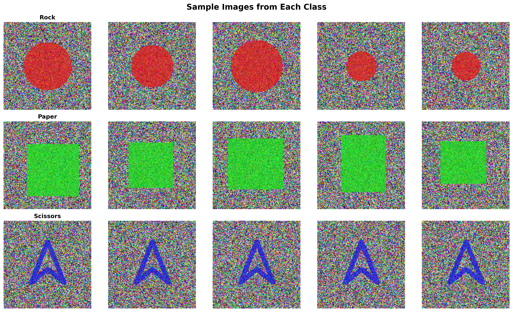
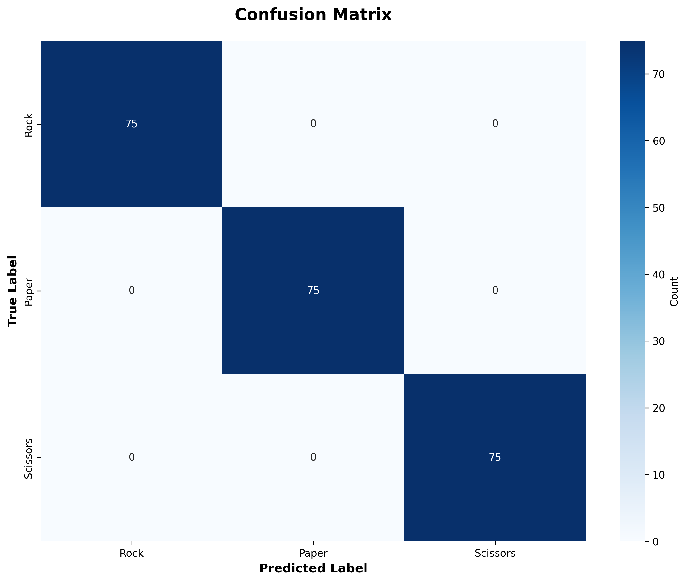
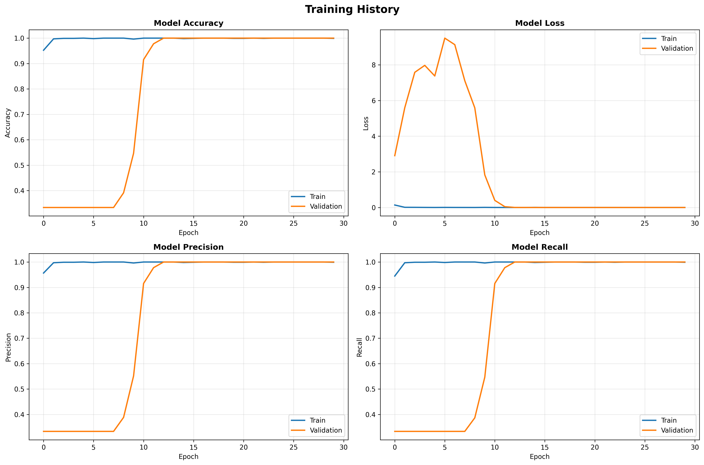
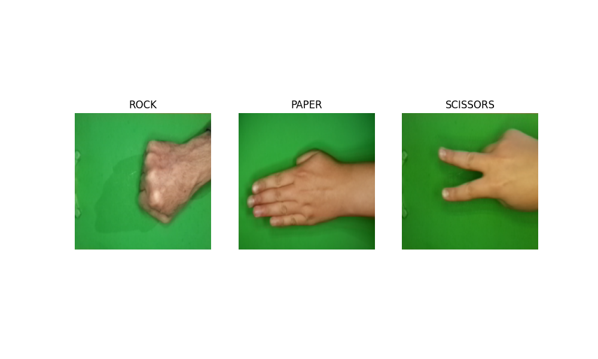
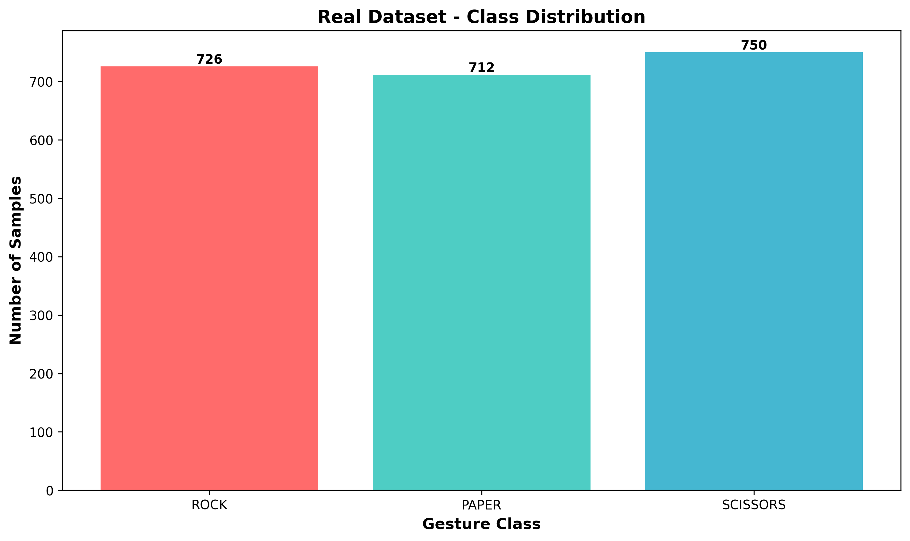
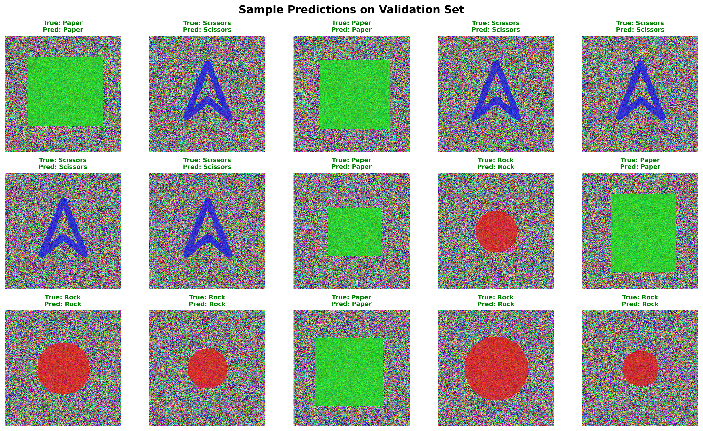

# ✊✋✌️ Hand Gesture Recognition (Rock / Paper / Scissors)

A CNN-based pattern recognition system that classifies hand gestures into Rock, Paper, or Scissors — built in two stages: a synthetic proof-of-concept to validate the full pipeline, then a real-world model trained via transfer learning on actual hand photos, plus a live webcam demo.

## Overview

Hand gesture recognition is a classic pattern recognition problem with real applications in human-computer interaction, touchless controls, and accessibility. This project builds the complete pipeline end to end: data acquisition → preprocessing → exploratory analysis → augmentation → CNN design → training → hyperparameter tuning → evaluation → live inference.

## Two Versions, Honestly Labeled

This repo actually contains **two separate experiments**, and it's worth being upfront about the difference:

### 1. Synthetic proof-of-concept (`HandGesture.py`)
Before working with real photos, the pipeline was built and validated on a **synthetic dataset of simple colored shapes** standing in for each gesture — a red circle for Rock, a green square for Paper, a blue triangle for Scissors, rendered over random noise backgrounds. This let the full 10-step pipeline (loading, preprocessing, EDA, augmentation, CNN architecture, training, tuning, evaluation, validation) get built and debugged cheaply before pointing it at real images.

Unsurprisingly, a CNN separates solid-colored geometric shapes almost perfectly — this version hits **100% accuracy**, which reflects how easy the synthetic task is, not real-world gesture recognition performance.

<p align="center">

</p>
<p align="center"><sub>Synthetic dataset samples — shapes standing in for gestures</sub></p>

<p align="center">


</p>

### 2. Real-world model (`RealHandGesture.py`, `best_real_model.keras`)
The second version trains on the [Rock-Paper-Scissors Images dataset](https://www.kaggle.com/drgfreeman/rockpaperscissors) — 2,188 real photos of hands making each gesture against a green background (dataset by Julien de la Bruère-Terreault / [`drgfreeman`](https://github.com/DrGFreeman/rps-cv), CC-BY-SA 4.0). This version uses **transfer learning on MobileNetV2** (frozen ImageNet-pretrained base + a small trainable classification head) rather than training a CNN from scratch, which works much better with a real, comparatively small (2,188-image) dataset.

<p align="center">

</p>
<p align="center"><sub>Real dataset samples — actual photographed hand gestures</sub></p>

<p align="center">

</p>

This is the model actually used for live webcam inference (`best_real_model.keras`, included in this repo).

## Model Architecture

**Synthetic/from-scratch CNN** (`HandGesture.py`):
- 3 convolutional blocks (32 → 64 → 128 filters), 3×3 kernels
- Batch normalization after each conv layer
- MaxPooling for spatial downsampling
- Dropout (0.25–0.5) for regularization
- 2 fully connected layers (256, 128 neurons)
- Softmax output over 3 classes
- ~1.5M trainable parameters

**Real-world transfer-learning model** (`RealHandGesture.py`):
- MobileNetV2 base (ImageNet weights, frozen)
- GlobalAveragePooling2D
- Dropout (0.5)
- Dense(3, softmax)

## Training Details

- **Optimizer:** Adam, initial LR 0.001, with `ReduceLROnPlateau` (factor=0.5, patience=5)
- **Batch size:** 32
- **Data augmentation:** rotation (±20–40°), width/height shift (±20%), zoom (±20%), horizontal flip
- **Early stopping:** monitors `val_loss`, patience 10 epochs
- **Split:** 70% train / 15% validation / 15% test (synthetic version), 80/20 train/validation (real version)

Full hyperparameter details are in [`hyperparameter_tuning.json`](hyperparameter_tuning.json).

## Results (Synthetic Version)

| Metric | Score |
|---|---|
| Accuracy | 100% |
| Precision | 100% |
| Recall | 100% |
| F1-score | 100% |

Full breakdown in [`evaluation_metrics.json`](evaluation_metrics.json). As noted above, this reflects a near-trivial synthetic classification task (solid shapes on noise backgrounds), not real-world gesture recognition accuracy — it validates that the pipeline itself works correctly.

<p align="center">

</p>

## Live Webcam Demo

Two demo scripts run the real-world model against your webcam in real time:

- **`LiveCameraDemo.py`** — simple version: draws a center detection box, classifies what's inside, color-codes the label by confidence (green if >80%, red otherwise)
- **`test_model.py`** — adds prediction smoothing (majority vote over the last 10 frames) for a more stable live label

```bash
python LiveCameraDemo.py
```

**Tips for best results:** good lighting, plain background (a white wall works well), hand centered in the on-screen box.

## Project Structure

```
└── 📁hand-gesture-recognition-cnn-main
    └── 📁assets
        ├── confusion_matrix.png
        ├── data_exploration_distribution.png
        ├── data_exploration_samples.png
        ├── real_data_distribution.png
        ├── real_data_samples.png
        ├── sample_predictions.png
        ├── training_history.png
    └── 📁demo
    └── 📁models
        ├── best_real_model.keras
    └── 📁notebooks
    └── 📁results
        ├── evaluation_metrics.json
        ├── hyperparameter_tuning.json
    └── 📁src
        ├── HandGesture.py
        ├── LiveCameraDemo.py
        ├── RealHandGesture.py
    └── 📁tests
        ├── test_model.py
    └── README.md
```

> **Note:** the synthetic-data model checkpoints (`best_model.keras`, `hand_gesture_model.keras`, ~100MB each) and the real dataset folder (`rps_dataset/`) are excluded from this repo via `.gitignore` — they're large and fully reproducible by running the scripts below.

## Running It

**Setup:**
```bash
pip install tensorflow opencv-python numpy pandas matplotlib seaborn scikit-learn
```

**Synthetic pipeline (from scratch, generates its own toy data):**
```bash
python HandGesture.py
```

**Real-world model (downloads the [Kaggle-style dataset](https://storage.googleapis.com/laurencemoroney-blog.appspot.com/rps.zip) automatically into `rps_dataset/` if not already present):**
```bash
python RealHandGesture.py
```

**Live webcam demo (needs `best_real_model.keras`, included in this repo):**
```bash
python LiveCameraDemo.py
# or, with prediction smoothing:
python test_model.py
```

## Tech Stack

- **TensorFlow / Keras** — CNN + MobileNetV2 transfer learning
- **OpenCV** — webcam capture and live inference
- **scikit-learn** — evaluation metrics
- **matplotlib / seaborn** — visualizations

## Future Improvements

- Fine-tune the MobileNetV2 base (currently frozen) for a further accuracy boost on real data
- Expand to more gesture classes beyond Rock/Paper/Scissors
- Package as a small web or mobile app for easier sharing/demoing

## Dataset Credit

Real hand gesture images: **Rock-Paper-Scissors Images** dataset by Julien de la Bruère-Terreault ([`drgfreeman`](https://github.com/DrGFreeman/rps-cv)), licensed CC-BY-SA 4.0.

---

*A personal computer vision / deep learning project exploring CNNs and transfer learning for gesture recognition.*
